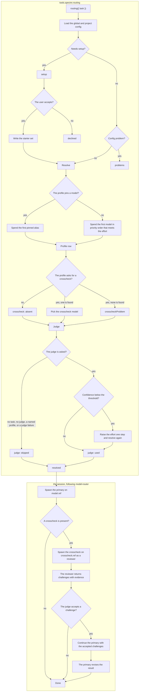

# The routing flow

This page shows the path the router follows, from the config to the model a session spends. It also shows the crosscheck review that follows the primary run. Read it when you need the full path for a scenario, or the prompt that starts a review.

## The path



`Needs setup?` is true only when the project has no config file and the merged config states no models, no profiles, and no `setup` marker. At the top rung, or on an effort name the order cannot rank, the raise changes nothing. When the raise does apply, the named row is resolved again, so its model and its crosscheck can change. The judge is not asked twice.

The router ends at `resolved`. It does not spawn a subagent, run a review, or revise a result. The session that reads the answer does those steps.

## The scenarios

| Scenario | The path | What the session does |
| --- | --- | --- |
| No project config | `setup` → the user accepts | Writes the starter set, resolves it, and spawns the primary. |
| No project config, the user says no | `setup` → `declined` | Spawns without a model. |
| A config problem | `problems` | Quotes the lines, says routing is misconfigured, and asks whether to continue. |
| The caller names a profile | `judge: skipped` | Takes that profile row. |
| There is no task and no judge | `judge: skipped` | Picks the profile from the `match` lines. |
| The judge fails | `judge: skipped` | Picks the profile from the `match` lines. |
| The judge chooses | `judge: used` | Takes the row named by `judge.profile`. |
| The judge is unsure | Raise the effort, then `judge: used` | Takes the escalated row. |
| The profile finds a crosscheck | Primary → review → judge | Accepts or rejects each challenge, then revises once when it accepts one. |
| The profile asks and finds no crosscheck | `crosscheckProblem` | Says the problem and spawns the primary without a review. |

## The crosscheck review

The crosscheck is a reviewer, not a second attempt at the task. The primary does the work. The reviewer reads that work and tries to break it. The session that routed the work is the judge.

### 1. Run the primary

Spawn the primary on `profile.model.ref`. Keep the child `sessionID`, because the revision continues that child.

### 2. Run the reviewer

Spawn the crosscheck on `profile.crosscheck.ref`, with the agent from the profile. Give it the task and the primary's result. Use this prompt:

```text
You are the crosscheck reviewer.

Task: <the task>
Primary result: <the result>

Review the result. List only concrete defects:
- a failing test or command, with its output
- a source that contradicts a claim, with the path and line
- a requirement the result missed
- an unsupported claim, with the evidence that is missing

Each defect needs evidence. If you find none, reply exactly: no challenge.
```

For a code change, tell the reviewer to read the worktree and run the checks it needs. It has the same tools as the primary.

### 3. Judge the challenges

Accept a challenge only when the evidence supports it. A different opinion is not a challenge. A style preference is not a challenge. A second guess with no evidence is not a challenge.

When you accept a challenge, keep the exact evidence. You will send it to the primary.

### 4. Revise once

Continue the primary with its `sessionID`. Give it the accepted challenges and their evidence. Ask for a revised result and a list of what changed. Do not run the whole task again, and do not start a new child.

One revision round ends the review. If the revision raises a new question, report it. Do not start a second review loop.

### 5. Say the outcome

One line: the profile, both refs, and the challenges you accepted. When you accepted none, say that the reviewer found no supported challenge.
